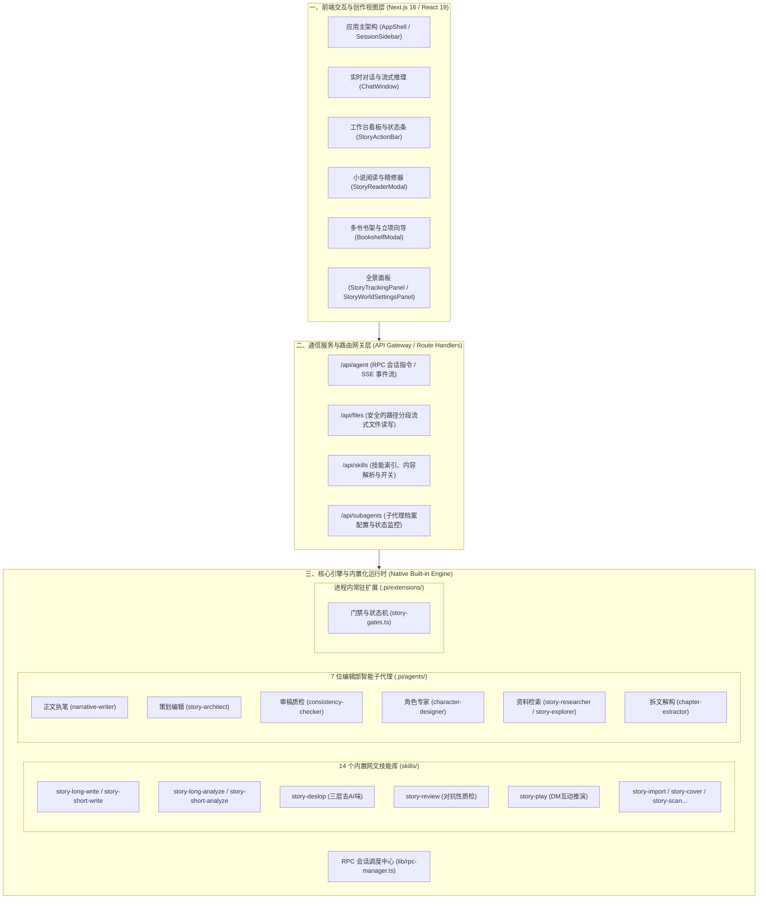

# Story-xY (ZenStory · 网文工坊)

<p align="center">
  <b>面向 AI 时代的全流程网文创作工作台与叙事工程底座</b><br>
  扫榜选材 · 拆解爆款 · 多轴大纲 · 场景写作 · 去AI味 · 伏笔治理 · 沉浸精修
</p>

<p align="center">
  <a href="https://github.com/demon820308/Story-xY"><b>GitHub 仓库</b></a>
  &nbsp;·&nbsp;
  <a href="#-核心特性矩阵"><b>核心特性</b></a>
  &nbsp;·&nbsp;
  <a href="#-快速上手"><b>快速上手</b></a>
  &nbsp;·&nbsp;
  <a href="#-7-位编辑部智能子代理"><b>智能子代理</b></a>
  &nbsp;·&nbsp;
  <a href="#-14-大专业网文技能"><b>专业技能</b></a>
  &nbsp;·&nbsp;
  <a href="#-系统架构"><b>系统架构</b></a>
  &nbsp;·&nbsp;
  <a href="#-项目结构"><b>项目结构</b></a>
</p>

<p align="center">
  
  
  
  
  <a href="./LICENSE"></a>
</p>

---

## 📖 项目简介

**Story-xY** 是一套面向长篇连载与短篇小说的专业级网文创作系统。它将**工业化叙事方法论**与**大语言模型**深度结合，打破了传统 AI 写作“易吃设定、AI味浓重、长文复读打转、逻辑结构失控”的瓶颈。

系统提供沉浸式 **Web 创作工作台**（基于 `@earendil-works/pi-coding-agent` SDK 与 Next.js）以及 **14 个专业创作技能**、**7 位智能子代理**构成的全链路创作底座。从选题策划、卷纲细纲拆解，到镜头级场景写作、三层去AI味润色、伏笔与时间线追踪，全流程保障百章以上的一致性与高完读率。

---

## ✨ 核心特性矩阵

### 1. 🖥️ 沉浸式网文工作台 (Web Studio)
- **三栏式创作视界**：
  - **左侧**：多书书架、目录卷纲、正文章节树直观导航；
  - **中栏**：大模型创作流与实时对话，支持分步审阅、推演决策与分支迭代；
  - **右侧**：全景状态看板（伏笔追踪、角色档案、世界观百科、双时间线对照）。
- **沉浸式小说阅读与精修器 (`StoryReaderModal`)**：
  - 纯净小说排版、字号间距自由调节，平滑切换章节；
  - 划词智能精修与高亮批注；
  - 一键进行“去AI味”前后对比（Diff 对照视图），成稿质感一目了然。
- **多书管理与立项向导 (`BookshelfModal`)**：
  - 长篇连载与短篇故事独立归档，支持一键切换活跃作品；
  - 开书向导按标准规范自动生成大纲、人物、设定与追踪账本骨架。

### 2. 🧠 7 位专业编辑部智能子代理 (Editorial Agents)
分工协作的编辑部机制，各自严守职责，防止单一 Prompt 职责过载导致质量劣质化：

| 子代理角色 | 职责定位 | 核心介入阶段 |
|:---|:---|:---|
| **策划编辑 (`story-architect`)** | 题材选择、核心梗设计、世界观构建、卷纲细纲、情绪弧线排布 | 开书定调、细纲推演、结构审查 |
| **正文执笔 (`narrative-writer`)** | 场景推进、镜头调度、情绪张力执行、三层去AI味用笔 | 单章执笔、场景重写、成稿打磨 |
| **审稿质检 (`consistency-checker`)** | 事实一致性与伏笔追踪，检测设定悖论、跨章因果断链（S1-S4 分级报告） | 审稿质检、长篇连载后校验 |
| **角色专家 (`character-designer`)** | 角色设定卡、语言风格档案、动机诉求链、人物弧线设计 | 开书定人、台词审稿、关系网构建 |
| **拆文解构 (`chapter-extractor`)** | 连续章节剧情事实提取、技法沉淀、跨章核心剧情归一 | 榜单爆款拆解、设定反推提取 |
| **资料研究 (`story-researcher`)** | 写作外部素材调研、真实背景核查、输出带引用的参考手册 | 动笔前查证、专业事实核验 |
| **状态查询 (`story-explorer`)** | 设定检索、角色当前状态、伏笔进度与时间线节点结构化召回 | 执笔前对标召回、日常查设定 |

### 3. 🛠️ 14 个专业网文技能覆盖全流程 (14 Built-in Skills)
1. **`story-long-write`**：长篇连载。主副双轴推进，镜头篇幅预算，5 级伏笔生命周期推进。
2. **`story-short-write`**：短篇精修。知乎/盐选/番茄短篇流派，反转证据闭环，快节奏钩子布局。
3. **`story-long-analyze`**：长篇拆文。5 维度评分雷达、卡点结构复盘、节奏密度拆解。
4. **`story-short-analyze`**：短篇拆解。反转节点定位、情绪落差曲线、伏笔埋设手法分析。
5. **`story-long-scan` / `story-short-scan`**：榜单扫榜。热点风向捕获、开篇黄金三章拆解。
6. **`story-deslop`**：三层去AI味专项。词汇/表达层、叙事手笔层、故事因果层的深度脱水去油。
7. **`story-review`**：对抗性质检。全方位审视吃设定、战力膨胀、机械降神与角色 OOC。
8. **`story-play`**：互动推演 (DM 模式)。基于当前设定的分支推演与角色自主行为沙盘模拟。
9. **`story-cover`**：封面生成。基于剧情核心意象与商业网文封面规范生成提示词与画面。
10. **`story-import`**：旧书/外部作品导入与自动规范化工程建立。
11. **`story-setup`**：环境自检、依赖初始化与跨平台宿主适配同步。
12. **`browser-cdp`**：基于 Chrome CDP 的安全资料抓取与参考素材采集。
13. **`story`**：意图总调度中心，快速路由至对应专业技能。

### 4. 🛡️ 确定性门禁与零污染运行时 (In-Process Engine)
- **外置记忆与结构化账本**：
  - 核心追踪状态维护在 `追踪/_tracking-state.json`，即使会话发生上下文压缩（Compact），系统亦能毫秒级从落盘文件恢复完整时间线与伏笔进度。
- **写前与写后门禁**：
  - 写前验证大纲结构与未决伏笔预算；
  - 写后拦截复读、未闭合截断、工程词泄露及常见 AI 词汇指纹。
- **全栈进程内原生集成**：
  - 资产在内存中直接调度挂载，不向系统全局目录写入多余临时文件，开箱即用。

---

## 🚀 快速上手

### 环境要求
- **Node.js**：`>= 22.19.0`
- **npm**：`>= 10.0.0`

### 1. 克隆仓库与安装依赖
```bash
git clone https://github.com/demon820308/Story-xY.git
cd Story-xY
npm install
```

### 2. 启动网文工坊 Web 工作台
```bash
npm run dev
```
控制台启动后，使用浏览器打开：
👉 **http://127.0.0.1:30141**

### 3. 配置模型提供商
在工作台右上角打开 **设置 (Settings) › 模型 (Models)**：
- 支持直连 **Google Gemini**、**Anthropic Claude**、**DeepSeek**、**OpenAI**、**Qwen** 等主流模型 API；
- 支持输入 API Key 或通过 OAuth 免密认证。

---

## 🏗️ 系统架构



---

## 📂 项目结构

```text
Story-xY/
├── app/                        # Next.js App Router 页面与 API 网关路由
│   ├── api/                    # RPC 会话、流式事件、文件读写、技能调度等接口
│   ├── layout.tsx              # 页面全局 Layout
│   └── page.tsx                # 应用主入口
├── components/                 # 前端核心 UI 组件库
│   ├── story/                  # 网文工坊核心专业组件
│   │   ├── ActiveBookCard.tsx        # 当前活跃书目卡片
│   │   ├── BookshelfModal.tsx        # 书架与多书管理弹窗
│   │   ├── NewBookModal.tsx          # 开书立项向导
│   │   ├── StoryActionBar.tsx        # 创作工作台快捷操作栏
│   │   ├── StoryReaderModal.tsx      # 沉浸式小说阅读/精修与对比弹窗
│   │   ├── StoryTrackingPanel.tsx    # 伏笔与时间线全景追踪面板
│   │   ├── StoryWorldSettingsPanel.tsx# 世界观设定百科面板
│   │   └── useActiveBook.ts          # 书籍状态响应式 Hook
│   ├── AppShell.tsx            # 应用主框架与三栏布局容器
│   └── ChatWindow.tsx          # 实时对话视窗与流式输出
├── skills/                     # 14 个网文创作专业技能库
│   ├── story-long-write/       # 长篇连载技能
│   ├── story-short-write/      # 短篇精修技能
│   ├── story-deslop/           # 三层去AI味重构
│   ├── story-review/           # 对抗性质检
│   ├── story-play/             # DM 互动推演沙盘
│   └── ...                     # 其余专业技能
├── .pi/                        # 原生内置 Agent 与扩展定义
│   ├── agents/                 # 7 位编辑部智能子代理提示词契约
│   └── extensions/             # 创作门禁守卫扩展 (story-gates.ts)
├── demo/                       # 示范项目与真实产物样例
│   ├── 长篇/                   # 完整长篇范例《让你管账号，你高燃混剪炸全网》
│   ├── 拆文库/                 # 经典网文拆解报告样例
│   └── 去AI味对照/             # 工业级去AI味真实修改对照记录
├── docs/                       # 系统详细架构与创作方法论参考文档
│   ├── architecture.md         # 架构全景文档
│   ├── how-to-remove-ai-flavor-from-web-fiction.md # 去AI味实战指南
│   └── keep-ai-novel-consistent-over-100-chapters.md # 百章设定一致性指南
└── package.json                # 工程依赖与执行脚本
```

---

## 🔌 多 Agent 宿主兼容

除了作为独立 Web 工作台启动，Story-xY 亦可原生作为 Skill 框架接入各大主流编程 Agent：

| 宿主 Agent | 接入机制 | 能力特点 |
|:---|:---|:---|
| **Google Antigravity (AGY)** | `.agents/` + Subagents | 支持直接派发 7 位智能子代理与生命周期门禁拦截 |
| **Claude Code** | `CLAUDE.md` + Plugin 规范 | 原生支持 Claude 3.7 / 3.5 Sonnet 推理与指令调用 |
| **OpenAI Codex** | `AGENTS.md` + TOML 代理描述 | 原生子代理环境、Python/Bash 门禁脚本 |
| **Pi Coding Agent** | `.pi/` 目录结构 | 深度整合 Pi SDK，完全复用底层工具链 |
| **OpenCode / ZCode / OpenClaw** | 插件清单与配置 | 跨平台自动化发现与技能路由 |

---

## 📜 许可证

本项目基于 [MIT License](./LICENSE) 开源。欢迎各类商业与个人创作者贡献、使用与二次开发。
