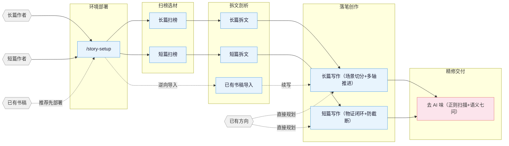

<p align="center">
  
</p>

<h1 align="center">Story-xY</h1>

<p align="center">
  <b>面向任意编程 Agent 的纯 Skill 网文创作框架：扫榜、拆文、多轴推进、伏笔治理、场景预算、去AI味、封面图全流程。</b>
</p>

<p align="center">
  <a href="https://zenstory.ai/zh/oh-story"><b>项目主页</b></a>
  &nbsp;·&nbsp;
  <a href="#安装"><b>安装</b></a>
  &nbsp;·&nbsp;
  <a href="#原生多-agent-适配"><b>多 Agent 适配</b></a>
  &nbsp;·&nbsp;
  <a href="#核心叙事工程资产"><b>核心技法</b></a>
  &nbsp;·&nbsp;
  <a href="#常见问题"><b>常见问题</b></a>
  &nbsp;·&nbsp;
  <a href="README_EN.md"><b>English</b></a>
</p>

<p align="center">
  
  <a href="./LICENSE"></a>
  
  
</p>

---

## 这是什么

**Story-xY** 是一套面向长篇连载与短篇小说的**纯 Skill 架构**网文创作工具集：**扫榜选材 → 拆解爆款 → 多轴大纲 → 场景级写作 → 去AI味 → 封面生成**。

它以 13 个 Skill 的形式装进你正在使用的编程 Agent。**写作用的模型就是该 Agent 自己的模型**，无需配置额外 API Key，不跑本地 LLM，运行时仅包含 Markdown 工作流/技法参考与纯 Node.js/Python 确定性门禁脚本。

### 核心设计原则

1. **宿主模型直驱（零额外开销）**
   - 不带私有模型接入层，不强制绑定商业 API。无论你使用 Claude Code（Claude 3.7 / 3.5 Sonnet）、Google Antigravity（Gemini 2.5 Pro / Flash）、OpenAI Codex、Pi Coding Agent 还是 OpenCode（DeepSeek-V3 / R1），直接复用当前 Agent 的推理与配额。
2. **全端原生适配（开箱即用）**
   - 仓库根目录原生预置各端适配配置：Google Antigravity（`.antigravity/` 与 `.agents/`）、OpenAI Codex（`.codex/`）、Pi Coding Agent（`.pi/` 与 `PI.md`）、Claude Code（`.claude-plugin/` 与 `CLAUDE.md`）、OpenCode（`opencode.json`）、ZCode（`.zcode-plugin/`）、OpenClaw（`.clawhub/`）、Reasonix（`reasonix-plugin.json`）。克隆即可被识别，无需手动配置。
3. **确定性门禁与守卫（防模型幻觉与退化）**
   - 写前门禁：长篇严格检验细纲结构、伏笔配额与追踪状态；
   - 写后门禁：拦截未封闭截断、逐行/长句复读打转、工程词泄漏，以及 `[润色备注]`、`【场景说明】`、`[字数：` 等模型指令遗留；
   - 确定性去味：基于正则扫描否定翻转、音量反差、套式声线、微动作堆叠等常见 AI 指纹。
4. **吸收自顶级叙事引擎的核心资产（白手重构，MIT 开源）**
   - 商业开篇 1-2-3 法则、单章主副双轴推进矩阵、场景级篇幅预算、伏笔 5 级生命周期治理、短篇反转证据闭环与第二层语义去味七问自查法。
5. **以文件系统为外置记忆**
   - 设定、大纲、正文、追踪独立落盘。通过唯一的结构化权威 `_tracking-state.json`，派生出上下文卡、伏笔视图、角色状态与「作者真相 / 读者已知」双时间线。即使上下文被压缩（compact）或开启新会话，也能从文件毫秒级完整恢复剧情。

---

## 原生多 Agent 适配

Story-xY 在仓库根目录已为你预置好各大主流 Agent 的原生运行配置：

| 宿主 Agent | 根目录配置与适配路径 | 运行时能力支持 |
|:---|:---|:---|
| **Google Antigravity (AGY)** | [`.agents/`](.agents/) 与 [`.antigravity/`](.antigravity/) | 13 个技能发现链接、7 个官方工具子代理（`agent.md`）、`always_on` 全局网文编排规则、PreToolUse/PostToolUse 拦截生命周期 |
| **OpenAI Codex** | [`.codex/`](.codex/) 与 [`AGENTS.md`](AGENTS.md) | 13 个技能发现链接、7 个原生 TOML 子代理描述、Python hooks、Windows CMD/Bash 启动器 |
| **Pi Coding Agent** | [`.pi/`](.pi/) 与 [`PI.md`](PI.md) | 13 个技能发现链接、Pi 扩展配置、根级系统指令接入 |
| **Claude Code** | [`.claude-plugin/`](.claude-plugin/) 与 [`CLAUDE.md`](CLAUDE.md) | Claude Code 插件协议规范与全局指引 |
| **OpenCode** | `opencode.json` | OpenCode 2.x 技能发现与正文守卫插件 |
| **ZCode** | [`.zcode-plugin/`](.zcode-plugin/) | ZCode 插件与原生命令/技能绑定 |
| **OpenClaw** | [`.clawhub/`](.clawhub/) | ClawHub 技能包与发布清单 |
| **Reasonix** | `reasonix-plugin.json` | Reasonix 技能与版本锁清单 |

---

## 核心叙事工程资产

Story-xY 将业内工业化写作框架经过干净室（Clean-Room）白手重写，沉淀为 5 项高可用叙事参考：

### 1. 场景级篇幅预算（[scene-budget.md](skills/story-long-write/references/scene-budget.md)）
- **镜头切分法则**：长篇单章（2000–3500 字）开章前切分为 2–4 个明确镜头（起笔施压 20%–25%、核心交锋 45%–55%、收尾余波 25%–30%），杜绝单场景拖满全章。
- **对白承载压力**：严禁无实质让步的信息对账式聊天；每句台词必须附带利益诉求与现场物理动作。
- **局部漂移定点修补**：字数偏差时**严禁整章重写**；仅精准定位虚胖或单薄的特定场景进行裁剪或增补。

### 2. 伏笔生命周期推进机制（[hook-advancement.md](skills/story-long-write/references/hook-advancement.md)）
- **四级操作明确区分**：严格界定 `mention`（闲聊提及，**不重置**遗忘计时）、`advance`（新实物物证/危机升级，**立即重置**计时）、`resolve`（收束结算）、`superseded`（作废撤销）。
- **五级兑现视野**：分为 `immediate`（1–3章）、`near-term`（3–10章）、`mid-arc`（10–30章卷终爆发）、`slow-burn`（30–100章长线暗斗）、`endgame`（全书终局底牌），防止高潮提前打光。
- **健康度红线**：单卷活跃伏笔控制在 5–8 条以内，临期未推进伏笔在排纲时强制触发裁决。

### 3. 商业开篇 1-2-3 法则与多轴推进（[progression-axes.md](skills/story-long-write/references/progression-axes.md)）
- **黄金三章留存模型**：
  - 第 1 章：300 字出场带压，1000 字冲突爆发，章尾抛出生死/利益核心悬疑；
  - 第 2 章：金手指/核心筹码实战兑现，打出直观小胜，确立爽点安全感；
  - 第 3 章：立住 3–5 章内必须达成的短周期倒计时目标，点燃追读引擎。
- **单章主副双轴推进矩阵**：每章正文必须推进至少 1 条主轴（战力/真相/死局）+ 1 条副轴（关系/资源/威望/格局）；主副轴全为 0 的章节直接判定为**结构性水章**。

### 4. 短篇反转证据闭环与防截断（[packaging-and-truth.md](skills/story-short-write/references/packaging-and-truth.md)）
- **三点物证前置**：核心反转前必须在前文埋下至少 2–3 处客观物理线索，严禁机械降神式突兀反转，保证读者二读自洽。
- **结尾防截断自查**：完结章必须核验因果落地、情绪收官与段落完形，杜绝无收尾标点的断句截断。
- **宣发包装事实锚定**：标题方案、黄金三句钩子、爆款标签与百字推文必须 100% 取材于定稿正文事实，拒绝欺诈式引流。

### 5. 语义去味七问自查法（[semantic-seven-questions.md](skills/story-deslop/references/semantic-seven-questions.md)）
在确定性脚本扫描后，以读者视角做第二层深度自检：
1. **叙事增量问**：这句话有剧情功能还是在同义反复？（无增量直接删）
2. **动作证据问**：情绪是靠形容词命名还是靠生理反应与动作呈现？
3. **标签清零问**：全文消灭“感到一丝……”、“心中暗暗……”、“神色复杂”等标签。
4. **现场质感问**：环境描写是否充斥通用模型套话？替换为专属物理细节。
5. **对白压迫问**：角色是在对账还是在进行利益试探与交锋？
6. **呼吸节奏问**：句式长短与当下危机程度是否匹配？
7. **元文本绝灭问**：彻底清除非小说正文的模型提示与标记。

---

## 安装与快速上手

### 方式一：命令行一键安装（推荐）

```bash
npx skills add zenstory-ai/oh-story-claudecode -y -g
```

`-g` 为全局安装，所有目录可用。更新时重复执行该命令即可。

### 方式二：直接对 Agent 提示

在支持直接加载 Git 仓库的 Agent 中输入：
```
安装这个 skill https://github.com/zenstory-ai/oh-story-claudecode
```

### 首次使用建议

装好后，在你的小说项目根目录下运行 `/story-setup`（Codex 使用 `$story-setup`），它会自动核验当前宿主环境的 hooks 与 agents 配置。

---

## Skills 清单（13 项）

**核心写作流程**：

| Skill | 触发指令 | 职责与能力说明 |
|:------|:-----|:-----|
| `story-setup` | `/story-setup` `$story-setup` `/准备写书` | 基础设施环境部署 · 检查并合并各宿主专用配置与钩子 |
| `story` | `/story` `$story` `/story dashboard` | 工具箱主路由 · 意图分发 + 本地小说工作台 Dashboard |
| `story-long-write` | `/story-long-write` `/写长篇` | 长篇连载写作 · 1-2-3开篇、卷纲细纲、场景字数预算、多轴推进、日更与追踪提交 |
| `story-short-write` | `/story-short-write` `/写短篇` | 短篇小说写作 · 情绪设计、反转构思、物证闭环、防截断完篇、宣发物料包装 |
| `story-deslop` | `/story-deslop` `/去AI味` | 去AI味 · 正则句式扫描 + 第二层语义七问自查改稿 |

**进阶与辅助工具**：

| Skill | 触发指令 | 职责与能力说明 |
|:------|:-----|:-----|
| `story-long-analyze` | `/story-long-analyze` `/长篇拆文` | 长篇拆文 · 黄金三章拆解、爽点节奏分析、人设立项报告 |
| `story-long-scan` | `/story-long-scan` `/长篇扫榜` | 长篇扫榜 · 起点/番茄/晋江等平台风口热榜数据与切口发现 |
| `story-short-analyze` | `/story-short-analyze` `/短篇拆文` | 短篇拆文 · 故事核提取、情绪曲线量化、50+ 情节点手法拆解 |
| `story-short-scan` | `/story-short-scan` `/短篇扫榜` | 短篇扫榜 · 知乎盐言/番茄短篇最新爆款榜单跟踪 |
| `story-import` | `/story-import` `/导入小说` | 逆向工程导入 · 将已有小说书稿反向重建为标准大纲与连续性工程 |
| `story-review` | `/story-review` `/审查` | 多视角专业审稿 · 连续性校验、多平台打分模型（番茄/起点/知乎） |
| `story-cover` | `/story-cover` `/封面` | 封面图生成 · 书名题材分析 + GPT-Image-2 提示词渲染 |
| `browser-cdp` | `/browser-cdp` | 浏览器操控底层 · CDP 协议复用登录态抓取实时榜单 |

---

## 创作流程总览



---

## 适用小说平台

- **长篇平台**：起点中文网 · 番茄小说 · 晋江文学城 · 七猫小说 · 刺猬猫
- **短篇平台**：知乎盐言故事 · 番茄短篇 · 七猫短篇 · 黑岩故事 · 点众

---

## 常见问题 (FAQ)

### Q: 可以在 Google Antigravity、OpenAI Codex、Pi Coding Agent 里直接用吗？
**可以，直接开箱即用。** 仓库根目录下已内置 `.antigravity/`、`.agents/`、`.codex/`、`.pi/` 以及各插件定义。用 Antigravity 打开工作区即可被 IDE 和 `agy` 发现；Codex CLI 启动即读取 `.codex/` 与 `AGENTS.md`；Pi Coding Agent 打开即加载 `.pi/`。

### Q: 需要自备 GPU 或单独购买商业模型 API 吗？
**完全不需要。** Story-xY 是纯 Skill 包，直接由宿主 Agent 自带的模型驱动写作；本地只运行极速、确定性的 Node.js / Python 文本检查脚本。唯一的外部图像能力是 `story-cover`（可选）。

### Q: 为什么字数控制能做到不漂移？
Story-xY 引入了**场景级篇幅预算（Scene Budget）**：在动笔前把整章 2000–3500 字拆分到 2–4 个具体镜头，分别分配戏剧任务与对白压力。如果出现字数偏差，仅针对偏离的场景做局部修补，绝不整章推倒重写。

### Q: 怎样防止写到后面烂尾或忘记前文伏笔？
系统通过 `_tracking-state.json` 进行伏笔生命周期治理：区分 `mention`（闲聊顺带提及，不重置遗忘计时）与 `advance`（实质推进新线索/风险加剧，重置计时），并设定 5 级兑现周期。超期未推进的伏笔将在排纲时被强制拦截预警。

### Q: 导入已经写了一半的书稿，能无缝续写吗？
可以。使用 `/story-import` 将已有章节文本反向重建为标准设定、大纲与连续性工程。系统严格以书稿证据为准，把“作者已知”与“读者已知”分开记录，避免角色提前知道未公开真相。

---

## 许可证 (License)

本项目采用 [MIT License](LICENSE) 开源许可证。所有叙事智能资产与代码均采用干净室白手构建，完全兼容商业使用与自由衍生。
