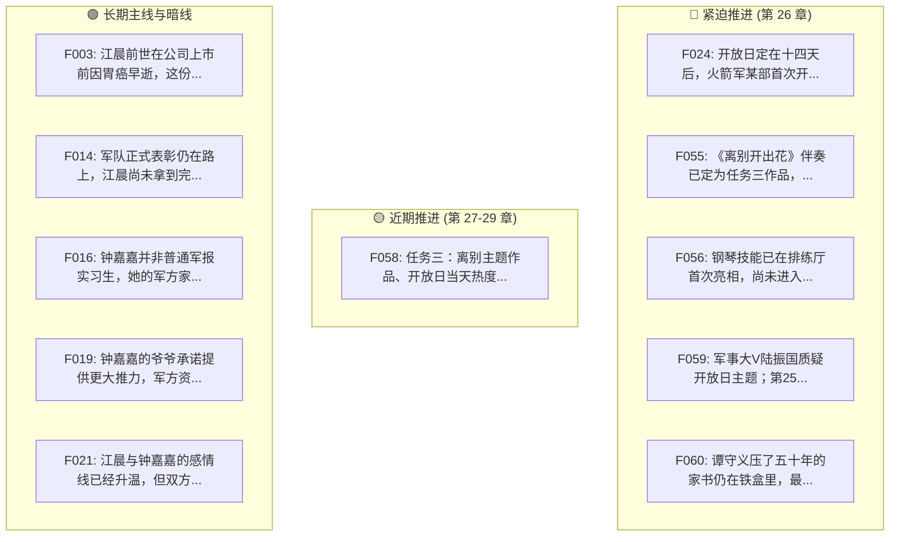

# 📊 《让你管账号，你高燃混剪炸全网》创作工作台全景看板

> 🔄 状态修订：rev.7 ｜ 🚀 写作坐标：第 25 章已落盘 ➔ 待写第 26 章 ｜ 🛡️ 门禁状态：细纲守卫 + AI指纹双重在线

---

## 🧭 一、创作坐标与主线倒计时

| 维度 | 当前设定与状态 |
| :--- | :--- |
| **所属分卷** | 第一卷·军宣整顿（候选） |
| **当前进度** | **第 25 章已完结** ➔ **准备起草第 26 章** |
| **故事时间** | 火箭军首次开放日当天上午十点 |
| **当前场景** | 营门外家属与老兵观礼区西头空地，江晨弹唱《离别开出花》 |
| **主线目标** | 任务三：离别主题作品、开放日热度 1000 万+、限时 14 天（当前倒计时剩余 11 天） |

### 📌 第 26 章剧情承诺清单
- 第26章兑现开放日全网传播反响与陆振国自媒体公开长文认错。
- 兑现系统任务热度破千万午夜结清与第一卷军宣整顿总结。

---

## 🎯 二、伏笔演进雷达 (Foreshadowing Kanban)

### 📋 活跃伏笔状态明细

| 编号 | 伏笔核心内容 | 埋设章 | 计划回收 | 重要性 | 状态 |
| :---: | :--- | :---: | :---: | :---: | :---: |
| **F024** | 开放日定在十四天后，火箭军某部首次开放；文工团承担宣传片与一个现场节目 | 第9章 | 第25章 | 🔴 高 | 已埋 |
| **F055** | 《离别开出花》伴奏已定为任务三作品，只弹过旋律，词未写 | 第20章 | 第25章 | 🔴 高 | 已埋 |
| **F056** | 钢琴技能已在排练厅首次亮相，尚未进入公开作品 | 第20章 | 第25章 | 🔴 高 | 已埋 |
| **F059** | 军事大V陆振国质疑开放日主题；第25章在媒体区亲眼见证营门外首演，第26章公开认错。 | 第23章 | 第26章 | 🔴 高 | 已埋 |
| **F060** | 谭守义压了五十年的家书仍在铁盒里，最终交给谁尚未解决 | 第22章 | 第26章 | 🔴 高 | 已埋 |
| **F058** | 任务三：离别主题作品、开放日当天热度1000万+、限时14天 | 第21章 | 第27章 | 🔴 高 | 已埋 |
| **F003** | 江晨前世在公司上市前因胃癌早逝，这份遗憾仍驱动他抓住重来机会 | 第1章 | 长期/待定 | 🟡 中 | 已埋 |
| **F014** | 军队正式表彰仍在路上，江晨尚未拿到完整嘉奖 | 第6章 | 长期/待定 | 🟡 中 | 已埋 |
| **F016** | 钟嘉嘉并非普通军报实习生，她的军方家庭背景仍未完全公开 | 第7章 | 长期/待定 | 🔴 高 | 已埋 |
| **F019** | 钟嘉嘉的爷爷承诺提供更大推力，军方资源仍有后续空间 | 第8章 | 长期/待定 | 🔴 高 | 已埋 |
| **F021** | 江晨与钟嘉嘉的感情线已经升温，但双方尚未说破 | 第8章 | 长期/待定 | 🔴 高 | 已埋 |
| **F023** | 首长授意亮剑亮肌肉，宏观战略宣传线仍会影响江晨的任务 | 第9章 | 长期/待定 | 🟡 中 | 已埋 |
| **F027** | 专业团队仍拍不出江晨原版的灵魂，继续验证其创作能力不可复制 | 第10章 | 长期/待定 | 🟡 中 | 已埋 |
| **F028** | 钟嘉嘉说江晨只猜对了一半，军方培养他的深层安排尚未揭示 | 第10章 | 长期/待定 | 🔴 高 | 已埋 |
| **F049** | 吴伟收到寻衅滋事公诉通知，最终法律结果尚未落地 | 第18章 | 长期/待定 | 🔴 高 | 已埋 |
| **F050** | 网友开始自发探访退伍老兵，社会影响仍会向线下扩散 | 第18章 | 长期/待定 | 🟡 中 | 已埋 |
| **F054** | 谭守义已给邻市地址，江晨定次日上门听故事 | 第20章 | 第22章 | 🔴 高 | 已回收 |
| **F057** | 谭守义讲了五十年的故事已在第22章说全：韩树生与那封没寄出的家书 | 第21章 | 第22章 | 🔴 高 | 已回收 |

---

## 👥 三、在场核心角色状态卡

| 角色 | 身份与定位 | 当前心境与动向 | 关键目标与悬念 |
| :--- | :--- | :--- | :--- |
| **江晨** | 火箭军文工团宣传兵；军宣顶流创作者 | 在营门外一台旧立式钢琴前沉稳弹唱《离别开出花》，镇住全场，引发现场强烈共鸣 | 完成开放日现场演出，引爆全网传播，午夜前达成一千万热度任务结清 |
| **钟嘉嘉** | 军报记者；具有尚未完全公开的军方家庭背景 | 在后排架机跟拍完演出全过程，现场被歌曲深深触动 | 记录下江晨在营门外首演的真实画面，为当晚新媒体报道和二次传播提供核心素材 |
| **陆振国** | 军事自媒体头部博主「铁马冰河」；原陆军某集团军宣传处干事，中校转业 | 坐在长桌后看着江晨演出，笔尖停在纸上未落，心中成见受到极大冲击 | 以专业军宣眼光审视江晨的作品是否配得上火箭军分量 |
| **周薄森** | 火箭军文工团副团长；分管新媒体 | 落实了营门外场地与乐器协调，目睹演出顺利开场 | 保证开放日宣传任务平稳安全落地，兑现组织保障 |

---

## 📈 四、章节字数与健康度监控

| 章节 | 规划目标 | 实际落盘 | 偏离度 | 质检判定 |
| :---: | :---: | :---: | :---: | :---: |
| 第 21 章 | 2300 字 | **2068 字** | -232 (-10%) | ✅ 合规达标 |
| 第 22 章 | 2400 字 | **2122 字** | -278 (-12%) | ✅ 合规达标 |
| 第 23 章 | 2500 字 | **2225 字** | -275 (-11%) | ✅ 合规达标 |
| 第 24 章 | 2500 字 | **2454 字** | -46 (-2%) | ✅ 合规达标 |
