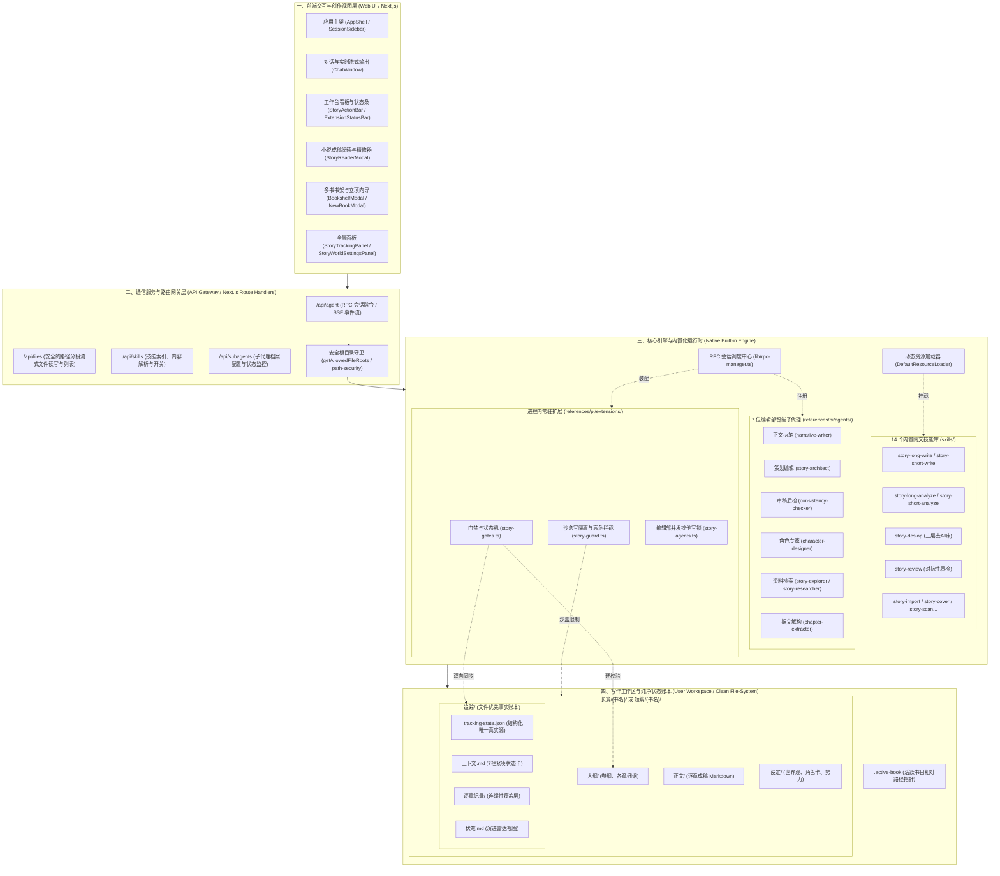
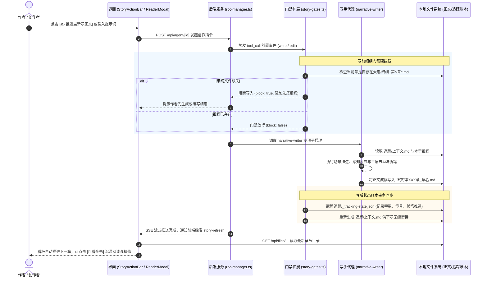

# Story xy Studio / Pi Web 架构全景文档

本项目是面向网文小说长篇连载与短篇精修的专业创作工作台。系统基于 `@earendil-works/pi-coding-agent` SDK 与 Next.js 构建，将大模型代理、文件系统状态账本、自动化创作门禁与现代化沉浸式阅读精修体验深度融合。

---

## 1. 系统全景架构图 (System Architecture)

整个系统采用**全栈进程内原生集成架构（In-Process Native Integration）**。所有 14 个网文创作技能、7 位编辑部智能子代理及门禁安全扩展均作为应用内置资产在内存中直接挂载，实现**零全局文件拷贝、零磁盘目录污染、跨工作区即开即用**。

---

## 2. 核心创作与质检时序图 (Interactive Flow)

以下展示了一次标准的正文推进交互全流程（包括前置细纲门禁、子代理执笔、去AI味后置扫描与文件状态落盘）：

---

## 3. 架构对比：内置化前后演进 (Evolution)

| 架构维度 | 早期版本 (Legacy Global Copy) | 现代化改造后 (Native Built-in Architecture) |
| :--- | :--- | :--- |
| **资产存放位置** | 运行时强行拷贝到用户主目录 `~/.pi/agent/` 和 `~/.agents/` | **100% 存放在应用内部** (`story-app/skills/` 与 `story-app/lib/`) |
| **启动与维护** | `bootstrap-story.js` 在服务启动时做递归全量复制，易死锁、产生冲突 | **零复制、启动秒开**；移除所有复制脚本，保护用户磁盘环境 |
| **技能发现机制** | 依赖全局 `~/.agents/skills/` 隐式搜寻 | `DefaultResourceLoader` 原生注入 `additionalSkillPaths` |
| **子代理挂载** | 拷贝 7 个 `.md` 到 `~/.pi/agent/agents/` | `subagents.ts` 动态扫描内部 `references/pi/agents/`，自动呈现在 Settings |
| **门禁与钩子** | `story-gates.ts` 跨盘符、跨绝对路径查找 `story_hook_core.js` | 内部相对模块规范导入，无外部硬编码路径，跨平台安全无缝 |
| **API 路径编码** | `encodeURIComponent` 误用导致 Windows 多段路径解析为单段 | 全面采用 `encodeFilePathForApi`，彻底杜绝数据反解失败 |
| **工作区纯净度** | 用户写作目录易混入环境探针与各种代码脚本 | **绝对纯净**：写作目录仅包含作者小说内容（大纲、正文、设定、追踪） |

---

## 4. 开发者代码地图 (Code Map)

进行二次开发或维护时，请参照以下关键模块索引：

### 4.1 后端服务与核心运行时 (`lib/`)
- [`lib/story-paths.ts`](file:///E:/story-app/lib/story-paths.ts)：内置技能、内置子代理、内置扩展及程序根目录的动态探测核心。
- [`lib/rpc-manager.ts`](file:///E:/story-app/lib/rpc-manager.ts)：Pi 会话中枢。在此为每一次会话装配 `additionalSkillPaths`、`story-gates`、`story-guard`、`story-agents` 扩展。
- [`lib/subagents.ts`](file:///E:/story-app/lib/subagents.ts)：子代理解析中心。在 `profileDirectories` 中注册内置子代理，保证前端与调度引擎可见。
- [`lib/subagent-runtime.ts`](file:///E:/story-app/lib/subagent-runtime.ts)：子代理派生控制器。确保子代理运行阶段继承内置技能库。
- [`lib/skills-service.ts`](file:///E:/story-app/lib/skills-service.ts)：技能 API 服务。挂载内置技能目录并生成带安装信息的技能视图。
- [`lib/allowed-roots.ts`](file:///E:/story-app/lib/allowed-roots.ts)：文件安全根目录。维护应用自身与写作目录的合法访问白名单。
- [`lib/file-paths.ts`](file:///E:/story-app/lib/file-paths.ts)：`encodeFilePathForApi` 等核心路径段转换工具。

### 4.2 前端小说专业组件 (`components/story/`)
- [`components/story/StoryReaderModal.tsx`](file:///E:/story-app/components/story/StoryReaderModal.tsx)：看全书弹窗。支持全书自然章节目录、阅览/精修模式双向切换、防抖自动落盘、去AI味/审稿质检一键触发及 JSON 外壳自愈解包。
- [`components/story/useActiveBook.ts`](file:///E:/story-app/components/story/useActiveBook.ts)：全工作区多书状态响应 Hook。自动扫描长篇/短篇目录、监听 `.active-book`、同步各书字数与当前进度。
- [`components/story/StoryActionBar.tsx`](file:///E:/story-app/components/story/StoryActionBar.tsx)：底部动态操作栏。根据大纲与正文的存在状态，动态提供出细纲、推进正文、看全书等一键式操作按键。
- [`components/story/StorySetupCard.tsx`](file:///E:/story-app/components/story/StorySetupCard.tsx)：轻量化立项引导卡片。无需大模型跑批，一键创建新书或快速生成基础书架目录骨架。
- [`components/story/BookshelfModal.tsx`](file:///E:/story-app/components/story/BookshelfModal.tsx)：多书书架弹窗。管理全书封面、状态切换与书目检索。
- [`components/story/StoryTrackingPanel.tsx`](file:///E:/story-app/components/story/StoryTrackingPanel.tsx)：伏笔账本与上下文连续性状态看板。

### 4.3 网文专用资产 (`skills/`)
- `skills/story-setup/references/pi/agents/`：7 位编辑部智能子代理定义（`narrative-writer.md`、`consistency-checker.md` 等）。
- `skills/story-setup/references/pi/extensions/`：网文专用进程内扩展插件：
  - `story-gates.ts`：细纲前置门禁、AI 腔调后置扫描、状态机。
  - `story-guard.ts`：限制写操作不溢出写作目录，拦截高危破坏命令。
  - `story-agents.ts`：编辑部槽位映射与正文并发排他写锁。

---

## 5. 二次开发避坑指南 (Best Practices & Traps)

1. **调用文件 API 严禁使用原生 `encodeURIComponent(path)`**：
   - 原因：Windows 或多级子目录（如 `长篇/书名/正文`）经 `encodeURIComponent` 处理后，斜杠会被转义为 `%2F`，导致 Next.js 的 `[...path]` 动态路由捕获为单个段而反解失败。
   - 规范：始终从 `@/lib/file-paths` 导入并使用 `encodeFilePathForApi(path)`。

2. **禁止硬编码磁盘盘符（如 `E:/` 或 `C:/`）**：
   - 原因：用户可能安装在任意驱动器或 Linux/macOS 环境下。
   - 规范：路径解析始终基于 `activeBook.path`、`cwd` 或 `lib/story-paths.ts` 动态定位。

3. **尊重追踪账本单向流契约（Tracking State Contract）**：
   - `追踪/_tracking-state.json` 是全书唯一权威结构化真实源。
   - `追踪/上下文.md`、`追踪/伏笔.md`、`追踪/角色状态/` 均为派生视图，应由 hook / 脚本自动生成，切忌直接手写改动派生文件以防状态冲突。

4. **子代理修改与发布**：
   - 7 个子代理的 Markdown 定义直接位于 `skills/story-setup/references/pi/agents/` 下，任何提示词或工具权限的修改在热重载或重启会话后即刻生效，无需向任何外部目录发布。
