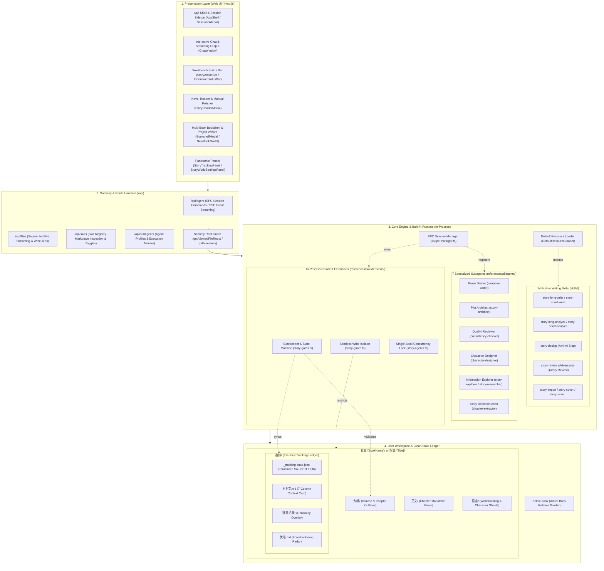
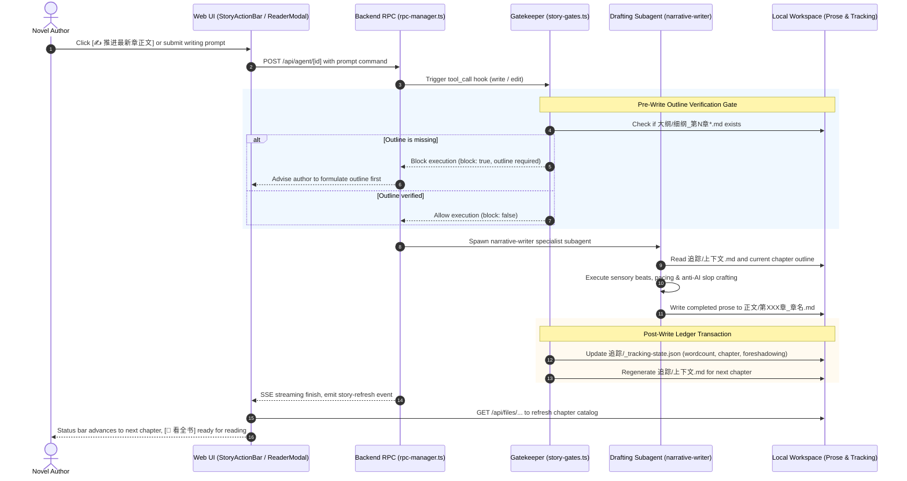

# Story xy Studio / Pi Web Architecture Overview

[中文版本](architecture.md)

Story xy Studio is a web-first creative workbench built on top of `@earendil-works/pi-coding-agent` SDK and Next.js, tailored for web novel serialized writing and short-story polishing.

---

## 1. System Architecture Overview

The system runs on an **In-Process Native Integration Architecture**. All 14 creative writing skills, 7 specialized editorial subagents, and writing guardrail extensions are loaded in memory directly from application assets without requiring copying to global directories (`~/.pi/agent/` or `~/.agents/`).

---

## 2. Interactive Flow Sequence

The diagram below illustrates a full turn of drafting a new chapter with pre-write outline gates, specialist agent execution, slop checks, and transactional state synchronization:

---

## 3. Key Evolution: Legacy Copy vs Native In-Process

| Dimension | Legacy Global Copy | Native Built-in Architecture |
| :--- | :--- | :--- |
| **Asset Location** | Files copied to `~/.pi/agent/` and `~/.agents/` on boot | **100% self-contained** within `story-app/skills/` and `story-app/lib/` |
| **Startup Overhead** | `bootstrap-story.js` performed recursive copies on startup | **Instant startup**; 0 file copy overhead |
| **Skill Discovery** | Relied on global `~/.agents/skills/` lookup | `DefaultResourceLoader` receives `additionalSkillPaths` |
| **Subagent Loading** | Copied `.md` to `~/.pi/agent/agents/` | `subagents.ts` scans internal `references/pi/agents/` dynamically |
| **Guardrails & Hooks** | `story-gates.ts` searched external drive paths for hook engine | Modular relative import; no hardcoded paths |
| **File API Encoding** | `encodeURIComponent` collapsed Windows slash segments | `encodeFilePathForApi` safely encodes multi-segment paths |
| **Workspace Purity** | Novel directory cluttered with external setup scripts | **Pure author files**: only outlines, prose, settings & tracking |

---

## 4. Developer Code Map

- [`lib/story-paths.ts`](file:///E:/story-app/lib/story-paths.ts): Dynamic resolver for built-in skills, agents, extensions, and app root.
- [`lib/rpc-manager.ts`](file:///E:/story-app/lib/rpc-manager.ts): Session factory. Injects `additionalSkillPaths`, `story-gates.ts`, `story-guard.ts`, and `story-agents.ts`.
- [`lib/subagents.ts`](file:///E:/story-app/lib/subagents.ts): Subagent controller. Discovers the 7 built-in writing subagents in `profileDirectories`.
- [`lib/subagent-runtime.ts`](file:///E:/story-app/lib/subagent-runtime.ts): Subagent runtime. Passes built-in skills to child subagents.
- [`lib/skills-service.ts`](file:///E:/story-app/lib/skills-service.ts): Skill API service powering Settings -> Skills.
- [`lib/allowed-roots.ts`](file:///E:/story-app/lib/allowed-roots.ts): Allowed file roots security whitelist.
- [`components/story/StoryReaderModal.tsx`](file:///E:/story-app/components/story/StoryReaderModal.tsx): Novel full-text reader & manual editor modal with debounced auto-save and quality triggers.
- [`components/story/useActiveBook.ts`](file:///E:/story-app/components/story/useActiveBook.ts): Multi-book directory scanner and reactive book state hook.
