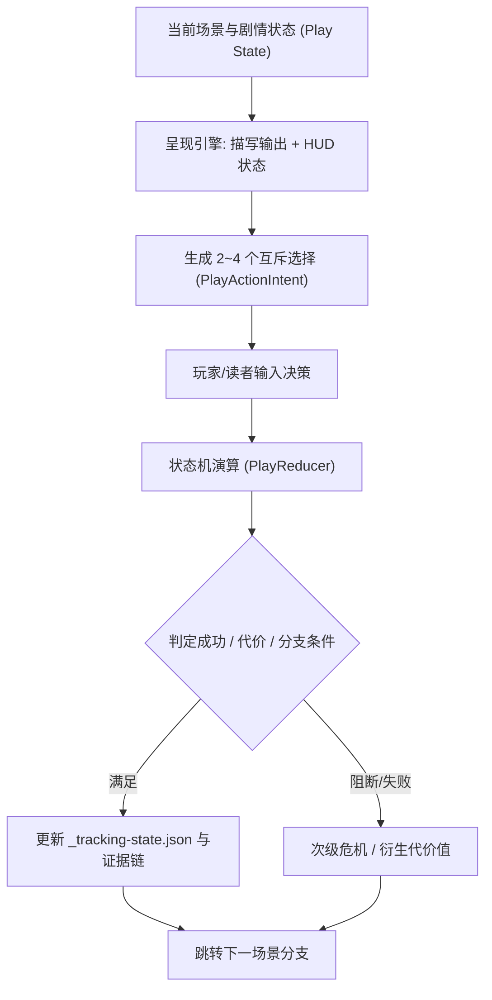

# Story-xY 交互叙事与分支演算引擎设计（实验性旁支）

> **分支声明**：本文档与规范仅存在于 `feature/interactive-play` 分支，用于探索从纯网文写作向**互动小说（CYOA / 交互式剧本 / 探索式文字冒险）**演进的原型架构。主干代码保持纯 Skill、零外部重型依赖。

---

## 1. 核心构想

在现有的 Story-xY 主线中，小说创作遵循确定性的单向时间线推进：
`大纲规划 -> 场景分镜与预算 -> 伏笔与暗线治理 -> 正文草拟 -> 去AI味`

而在 `feature/interactive-play` 旁支中，我们将 Story-xY 的文件化状态引擎（`_tracking-state.json` 与 `追踪/`）拓展为**可分支探索的交互叙事状态机（State-Machine Game Loop）**：
- **读者/玩家视角**：每个核心场景（Beat / Scene）提供 2-4 个符合人物动机与当下情境的抉择分支（Action Intent）。
- **作者/策划视角**：保持单一真相库（Author Truth），所有分支共享统一的人物设定、证据链与世界规则，由状态机（Reducer）负责判定条件与分支跳转。

---

## 2. 状态演算模型（Play State Model）

不同于单向连载小说，互动叙事需要明确的实体与意图映射：



### 核心实体分类 (PlayEntityType)

- **`actor`（角色）**：具有独立动机、关系好感度与行动约束的角色。
- **`location`（场景/地点）**：空间属性与环境细节，承载探索线索。
- **`item`（关键道具）**：具有物理属性或剧情权杖地位的实体。
- **`evidence / clue`（线索与物证）**：驱动解谜与反转的物理证据。
- **`proof_chain`（推论链条）**：由多个 Clue 拼合而成的决定性指控或认知突破。
- **`rule`（世界观规则）**：不可逾越的物理/魔法/社会机制。

---

## 3. 意图解析与选择面板 (PlayActionIntent)

每个分支选项不应只是冷冰冰的“选项 A / 选项 B”，而是包含动作意图、风险评估与执行风格的语义结构：

```json
{
  "actionKind": "confront_or_probe",
  "targetEntityLabel": "林远舟",
  "targetLocationLabel": "书房暗格",
  "intent": "当面质问玉佩来源，试探其是否已知晓当年真相",
  "manner": "不动声色、指尖扣在暗器机簧上",
  "risk": "若对方已有防备，将彻底撕破脸皮并触发紧急警戒",
  "ambiguity": "无法确定对方是否故意留下破绽",
  "secondaryActions": ["观察对方微表情", "封锁退路"]
}
```

---

## 4. 与 Story-xY 主线的结合路径

1. **复用伏笔追踪系统**：将 `hook-advancement` 中的伏笔追踪机制映射为分支触发器（Trigger Conditions），例如伏笔处于 `escalated` 状态时才解锁隐藏分支。
2. **复用场景字数预算**：每个分支子场景沿用 `scene-budget.md` 控制在 800-1500 字，保证节奏紧凑、绝不拖泥带水。
3. **去AI味双层过滤**：分支剧情生成同样经过 `story-deslop` 7 问自检，剔除伪深沉与套路化说理。

---

## 5. 当前阶段与演进规划

- [x] **架构预研**：提取 InkOS v2 原型的 Play 状态机与实体类型设计规范。
- [x] **分支隔离**：建立 `feature/interactive-play` 实验分支，完全不影响主线连载创作工具链。
- [ ] **交互式 CLI Demo**：编写轻量交互脚本，在终端实现基于本地 Markdown 剧本的分支推演体验。
- [ ] **Web 播放器适配**：探索将 Story-xY 本地 Dashboard 扩展为带选择交互与立绘/封面展示的 StoryPlayer。
